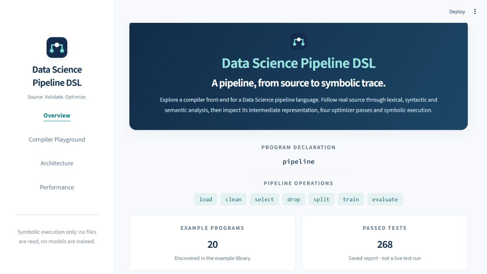

# Data Science Pipeline DSL

A Python compiler front-end for a small language that describes data science pipelines. Inspect how source becomes tokens, an abstract syntax tree, a symbol table, intermediate instructions, optimized instructions and a readable execution trace.

**[Live demo](https://ds-pipeline-compiler.streamlit.app/)** · **[GitHub repository](https://github.com/Sinchana-B-Kurkuri/A-Domain-Specific-Language-and-Compiler-Front-End-for-Data-Science-Pipelines)** · [Architecture](docs/architecture.md) · [Grammar](docs/grammar.md)


**Execution is symbolic.** Dataset and algorithm names are declarations: no CSV contents are read, no models are fitted, and no numerical accuracy or predictions are computed.



## Why this project

A pipeline description contains dependencies that can be checked before a runtime starts: a training split must exist before training, a model must exist before evaluation, and selected columns cannot have been dropped. This project makes those rules explicit in a compact DSL and exposes each compiler representation for inspection.

The objectives are to design an unambiguous grammar, implement a modular compiler, report source-based diagnostics, transform an explicit IR, and validate transformations with automated tests. The result is a compiler construction project with a data science vocabulary, rather than a workflow scheduler or ML training platform.

## What it implements

- Regex lexer with source coordinates, comments, whitespace handling and lexical diagnostics.
- Hand-written recursive-descent parser, one-token lookahead and dataclass AST nodes.
- Symbol-table analysis with 21 explicit semantic checks for declarations, ordering, columns and partitions.
- Seven IR opcodes, source-line metadata and four ordered optimization passes.
- Symbolic executor and CLI with selectable output sections and meaningful exit codes.
- Four-page Streamlit dashboard that calls the same compiler modules.
- Valid, invalid, complex and optimization examples; unit, integration, boundary and equivalence tests.

## Compilation workflow


Both the CLI and dashboard coordinate this workflow. The first lexical, syntax or semantic error stops later stages. The dashboard retains completed intermediate results and highlights the reported source location.

| Stage | Main implementation | Result |
|---|---|---|
| Lexical analysis | [lexer.py](src/ds_pipeline_dsl/lexer.py) | `Token(type, value, line, col)` records |
| Syntax analysis | [parser.py](src/ds_pipeline_dsl/parser.py) | `PipelineNode` and statement dataclasses |
| Semantic analysis | [semantic.py](src/ds_pipeline_dsl/semantic.py) | Declaration/state checks and `SymbolTable` |
| IR generation | [ir.py](src/ds_pipeline_dsl/ir.py) | `IRInstruction(op, args)` list |
| Optimization | [optimizer.py](src/ds_pipeline_dsl/optimizer.py) | Transformed IR and optional notes |
| Symbolic execution | [executor.py](src/ds_pipeline_dsl/executor.py) | Formatted instruction log |

The IR is an opcode-and-arguments representation, not machine code or conventional arithmetic three-address code. See the [architecture and safety discussion](docs/architecture.md).

## Language at a glance

A file has one `pipeline` declaration and seven possible body statement forms. Statements end in semicolons; `//` introduces a comment.

| Construct | Example | Meaning |
|---|---|---|
| Program declaration | `pipeline demo { ... }` | Names the single pipeline |
| Load | `load "students.csv";` | Declares a symbolic dataset source |
| Clean | `clean missing_values;` | Records a cleaning strategy |
| Select | `select cgpa, attendance;` | Sets the current selected columns |
| Drop | `drop student_id, name;` | Records excluded columns |
| Split | `split train = 80%;` | Declares a named percentage partition |
| Train | `train model = decision_tree;` | Declares a model and algorithm |
| Evaluate | `evaluate model;` | Requests evaluation of an existing model |

From [valid_drop.pipe](examples/valid_drop.pipe):

```text
pipeline student_prediction {
    load "students.csv";
    clean missing_values;
    drop student_id, name;
    select cgpa, attendance, study_hours;
    split train = 80%;
    train model = decision_tree;
    evaluate model;
}
```

A load is required before data operations; clean/select/drop must precede the first training declaration. Each split must be strictly between 0 and 100, with a cumulative total at most 100 (subject to the implementation's floating-point tolerance). Names of splits and models must be unique. After a selection, a drop must use currently selected columns and leave at least one.

Cleaning strategies and algorithms are free identifiers, not validated library names. An empty pipeline is accepted. Evaluation is not terminal: later training and evaluation statements can be legal. The [full grammar](docs/grammar.md) documents keyword and lexical details.

## Run locally

Requires **Python 3.12+**. The compiler has no third-party runtime dependencies. Streamlit is optional for the UI, and pytest is optional for testing. The audit environment used Python 3.14.7, Streamlit 1.66.0 and pytest 9.1.1; other Python versions were not executed during this audit.

From the repository root in PowerShell:

```powershell
python -m venv .venv
.\.venv\Scripts\Activate.ps1
python -m pip install -e ".[dashboard,test]"
python -m ds_pipeline_dsl.cli examples/valid_basic.pipe --trace
python -m streamlit run dashboard/app.py
```

On macOS/Linux, replace activation with `source .venv/bin/activate`. For the compiler alone, install with `python -m pip install -e .`. The existing `python -m pip install -r requirements-dashboard.txt` command remains supported. Open [localhost:8501](http://localhost:8501) while the server is running; stop it with Ctrl+C. If the port is occupied, use `--server.port 8502` and open port 8502. See [deployment and troubleshooting](docs/deployment.md).

## CLI and actual output

```powershell
python -m ds_pipeline_dsl.cli examples/valid_drop.pipe --trace
python -m ds_pipeline_dsl.cli examples/optimizer_demo.pipe --ir --optimized-ir
python -m ds_pipeline_dsl.cli examples/invalid_train_before_split.pipe --trace
```

The first command prints:

```text
=== TRACE ===
Loaded students.csv
Cleaned using missing_values
Dropped columns: student_id, name
Selected columns: cgpa, attendance, study_hours
Defined split 'train' = 80%
Trained model 'model' using decision_tree
Evaluated model 'model' (simulated accuracy trace)
```

The last phrase is an existing trace label, not a computed accuracy score. The invalid example exits with code 1 and prints:

```text
Semantic Error at line 5: training data has not been defined. A 'split train = <percent>%;' statement must appear before 'train model = decision_tree;'.
```

Flags are `--tokens`, `--ast`, `--ir`, `--optimized-ir` and `--trace`. With no flags, all five output sections are displayed. Flags control display; they do not stop compilation early. Successful runs exit 0; handled compiler/file-reading errors exit 1 and print to stdout. Lexer line numbers are one-based and columns zero-based. [Captured CLI examples](docs/demo_outputs/) include full intermediate outputs and exit codes.

## Optimization and correctness

| Order | Pass | Transformation |
|---|---|---|
| 1 | `_remove_unreachable` | Removes only the tail after the **last** `OP_EVAL` |
| 2 | `_remove_dead_trains` | Removes training declarations whose models are never evaluated |
| 3 | `_merge_adjacent_drops` | Merges immediately adjacent drop runs, retaining ordered unique columns |
| 4 | `_collapse_duplicates` | Collapses adjacent equal clean/select operations, excluding source-line metadata from equality |

[optimizer_demo.pipe](examples/optimizer_demo.pipe) reduces **11 instructions to 7**, with notes from all four passes. [complex_multi_model.pipe](examples/complex_multi_model.pipe) preserves both evaluations while reducing 10 instructions to 9.

Correctness is tested against evaluation records containing model name, algorithm, training-state snapshot and evaluation-state snapshot. Full textual traces can change after optimization. Adjacent identical cleaning is treated as idempotent by this symbolic model; this is not a guarantee about arbitrary real cleaning functions. Without an evaluation, the two removal passes are conservative, while merging and duplicate collapse can still apply.

## Interactive dashboard

| Page | What to explore |
|---|---|
| Overview | Project scope, constructs, example count, saved test evidence and visible grammar |
| Compiler Playground | Example library, editor, Compile action, six output tabs, source diagnostics and IR comparison |
| Architecture | Pipeline diagram, collapsible stage details and last-run stage status |
| Performance | Saved environment and timings, stage/scaling/IR charts, observations beside the analysis |

Compilation results persist until Compile is pressed again. Source edits show a stale-result notice. The UI limits input to 100,000 characters and displays at most 1,000 token rows while retaining EOF information. IR change labels are a best-effort comparison, not optimizer provenance. The Performance page reads a saved report and never runs benchmarks automatically.

[Dashboard screenshots and capture details](docs/screenshots/README.md) · [Five-minute demonstration](docs/demo.md)

## Testing

```powershell
python -m pytest -v
```

**268 passed, 0 failed, 0 skipped** on 23 October 2026, including **44 dashboard tests**. The suite covers tokenization, grammar, all implemented semantic checks, IR lowering, optimizer equivalence/idempotence and sensitivity, execution, CLI, boundaries, examples, benchmark guards and Streamlit AppTest interactions. All 20 supplied `.pipe` examples were executed: seven accepted and thirteen rejected (one lexical, one syntax, eleven semantic).

The badge is a dated verified result, not a live CI indicator. Coverage was not measured. Timing varies by machine; no fixed test-duration promise is made. [Full test log](docs/test_results.txt) · [Audit results and limitations](docs/verification.md) · [Machine-readable evidence](docs/verification_results.json)

## Recorded performance

The dashboard's saved benchmark was measured on Windows with Python 3.14.7 on **22 October 2026**. Selected columns below are copied from [the complete measurements](docs/performance.md):

| Actual statements | Total ms | µs/statement | Original IR | Optimized IR | Reduction |
|---:|---:|---:|---:|---:|---:|
| 13 | 0.098 | 7.54 | 13 | 8 | 38.5% |
| 99 | 0.671 | 6.78 | 99 | 60 | 39.4% |
| 999 | 6.952 | 6.96 | 999 | 600 | 39.9% |
| 9999 | 73.560 | 7.36 | 9999 | 6000 | 40.0% |

`Total ms` sums the lexer, parser, semantic, IR, optimizer and optimized-executor medians; it excludes the separately measured unoptimized executor. The 0.63-second harness wall time is a different measurement. Nominal generator sizes 10/100/1000/10000 produce the actual statement counts shown above.

```powershell
python benchmarks/benchmark.py
```

This command prints a new report and **overwrites `docs/performance.md`**. The audit instead called the benchmark functions and stored fresh results separately in [verification_results.json](docs/verification_results.json). All four fresh rows completed successfully, and evaluation-record equivalence was checked at every size.

The measurements describe one synthetic template on one machine. They support approximately linear scaling for that workload, not a universal complexity proof. Repeated split-total summation and column-list operations can depend on input shape. Benchmark budget checks use projections and post-run thresholds, not preemptive timeouts. No memory profile or numerical ML result is claimed.

## Repository guide

```text
src/ds_pipeline_dsl/     Compiler package and CLI
dashboard/              Streamlit UI, compiler adapter, benchmark loader and logo
tests/                  Unit, integration, equivalence and dashboard tests
examples/               20 .pipe programs and a frontend demonstration script
benchmarks/             Synthetic benchmark and correctness guards
docs/                   Current technical docs, captures, evidence and phase materials
final_report/           Final DOCX/PDF, build sources, figures and historical evidence
.streamlit/             Shared dashboard theme
pyproject.toml          Package metadata and optional dependency groups
requirements.txt        Community Cloud dependency entry point
```

Academic reports and review decks are retained under `docs/`; the [final PDF](final_report/Final_Report.pdf) and [editable report](final_report/Final_Report.docx) remain unchanged. Historical reports describe their own phase and are not current API or test-count specifications.

## Limitations and next steps

Current limits include symbolic execution, one pipeline per file, first-error reporting, no dataset-schema validation, no general type inference, and free strategy/algorithm identifiers. There are no loops, functions, warning severities or cross-pipeline scopes.

Possible extensions are schema-aware validation, optional restricted vocabularies, multiple-pipeline scopes, diagnostic recovery, and a separate real execution backend. Real execution would require new runtime semantics and a fresh review of optimization safety.

For navigation, start with [architecture](docs/architecture.md), [grammar](docs/grammar.md), [deployment](docs/deployment.md), [verification](docs/verification.md), and the [academic review checklist](docs/report_and_presentation_checklist.md).
