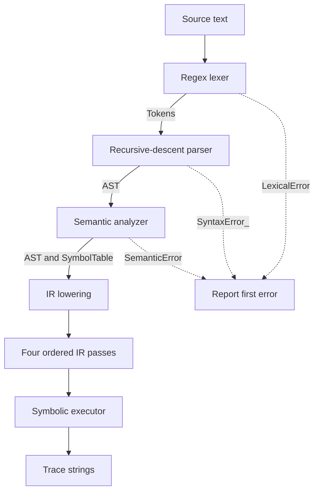

# Compiler architecture

The compiler analyzes a restricted pipeline language and produces a symbolic instruction log. No dataset contents, estimator objects or numeric metrics are created. The [README](../README.md) provides runnable examples; the [grammar](grammar.md) is the language reference.

## Data flow

The CLI coordinates all stages. Its flags select printed results rather than execution stages. The dashboard's adapter invokes these same functions, times them, retains completed results after failure, and stores source text and diagnostics. It does not substitute example-specific compiler results.

## Modules

| Module | Responsibility |
|---|---|
| [lexer.py](../src/ds_pipeline_dsl/lexer.py) | Ordered regex alternatives; keyword conversion; `Token` dataclasses; source coordinates |
| [parser.py](../src/ds_pipeline_dsl/parser.py) | One-token lookahead; statement parsing; delimiters; one pipeline and EOF |
| [ast_nodes.py](../src/ds_pipeline_dsl/ast_nodes.py) | Pipeline root and seven body-statement dataclasses |
| [semantic.py](../src/ds_pipeline_dsl/semantic.py) | Declaration, order, split and column-state validation |
| [ir.py](../src/ds_pipeline_dsl/ir.py) | Instruction dataclass and statement-to-opcode lowering |
| [optimizer.py](../src/ds_pipeline_dsl/optimizer.py) | Four ordered transformations and optional notes |
| [executor.py](../src/ds_pipeline_dsl/executor.py) | Formats one string per instruction |
| [cli.py](../src/ds_pipeline_dsl/cli.py) | UTF-8 source reads, argparse flags, orchestration and exit codes |
| [dashboard/compiler_runner.py](../dashboard/compiler_runner.py) | Pure presentation adapter, partial results, timing and example discovery |
| [dashboard/performance_loader.py](../dashboard/performance_loader.py) | Parses saved benchmark headers/numeric cells and preserves section text |
| [dashboard/app.py](../dashboard/app.py) | UI routing, editor, tables, source highlighting and diagrams |

AST type annotations document fields; they do not implement a general runtime type checker. `lower_to_ir` accepts a symbol table parameter but does not read it; drivers perform analysis before lowering.

## Symbol table and validation

The analyzer performs one left-to-right traversal and initializes ten fields:

| Field | Role |
|---|---|
| `data_loaded` | Whether a load has been accepted |
| `data_cleaned` | Whether any cleaning declaration has been accepted |
| `load_line` | First load's line for duplicate diagnostics |
| `selected_columns` | Current ordered selection, or `None` before selection |
| `dropped_columns` | Dropped names mapped to their first drop lines |
| `splits` | Split names mapped to percentages |
| `split_lines` | Split definition lines |
| `models` | Model names mapped to algorithm identifiers |
| `model_lines` | Model definition lines |
| `first_train` | First trained model name and line |

The 21 explicit semantic raise sites cover duplicate/empty loads; clean/select/drop before load or after training; duplicate selected/dropped columns; selecting or dropping previously dropped columns; dropping outside the current selection or dropping every selected column; splits before load, out-of-range percentages, duplicate splits and cumulative overflow; training without a `train` split, duplicate models, and evaluation before training.

Each percentage must satisfy `0 < p < 100`. The cumulative comparison is `total > 100 + 1e-9`. The analyzer checks relationships in source declarations, not a physical CSV schema. A drop before any selection is permitted after load. After selection, it must use currently selected names and retain at least one. Clean, select and drop cannot follow the first train. Splits after training and repeated evaluations can be legal. An empty pipeline is accepted, and cleaning, a test split and evaluation are not mandatory.

Strategies and algorithms remain ordinary identifiers. A source file has one pipeline; multiple scopes, general type inference and allowed-value catalogs are not implemented.

## Intermediate representation

`IRInstruction` stores `op: str` and `args: dict`. Lowering maps every body statement to one instruction in source order; the pipeline root has no opcode.

| Opcode | Arguments |
|---|---|
| `OP_LOAD` | `filename`, `line` |
| `OP_CLEAN` | `strategy`, `line` |
| `OP_SELECT` | `columns`, `line` |
| `OP_DROP` | `columns`, `line` |
| `OP_SPLIT` | `name`, `percent`, `line` |
| `OP_TRAIN` | `model_name`, `algorithm`, `line` |
| `OP_EVAL` | `model_name`, `line` |

These records are a domain IR, not arithmetic three-address code. Source lines remain available for optimizer notes and UI inspection.

## Optimization safety

Passes execute in this order:

1. `_remove_unreachable` retains instructions through the **last** evaluation. With no evaluation it copies the sequence unchanged.
2. `_remove_dead_trains` scans backward for model names required by evaluations, removing unused training. This pass is also conservative when no evaluation exists.
3. `_merge_adjacent_drops` merges immediately adjacent drop runs and preserves ordered unique columns. Intervening instructions prevent merging.
4. `_collapse_duplicates` removes adjacent identical cleaning or selection instructions. Ordered column lists and strategies must match; only line metadata is excluded from equality.

The correctness target in [tests/helpers.py](../tests/helpers.py) is a sequence of `(model_name, algorithm, train_state, eval_state)` records. State snapshots contain cleaning history, selected columns, the dropped-column set and sorted split entries. The training and evaluation snapshots are separate because legal splits can occur between them.

Under this model, adjacent equal cleaning is idempotent. This assumption is not a statement about arbitrary real cleaning functions. Data preparation cannot follow training in accepted source, so removing an unused train does not bring previously separated preparation operations together. Instructions after the final evaluation cannot affect a later evaluation. Trimming after the first evaluation would be incorrect for a legal multi-model program.

The optimizer's text trace may differ from the original: a merged drop changes its log entry and a removed train has no log entry. Evaluation-record equality, operation order, input preservation, idempotence, individual-pass cases and sensitivity tests provide the validation. This is not a proof for every possible hand-built IR or any future real runtime. Without evaluations, merge and duplicate passes may still change the IR.

## Errors and execution

The compiler exposes `LexicalError`, `SyntaxError_` and `SemanticError`. Lexical messages include a line and zero-based column; syntax and semantic messages include a line. CLI-handled errors print to stdout and exit 1. Compilation stops at the first error; source may already have produced earlier printed sections.

The executor returns formatted strings rather than reading a CSV or fitting a model. The text `simulated accuracy trace` is a label without a numeric score. Unknown opcodes produce an `Unknown instruction` message. The dashboard additionally handles oversized input and unexpected exceptions; these are adapter categories, not new language rules.

## Performance boundaries

Timing is measured by stage, with unoptimized execution recorded separately. Most stages traverse their input, but costs also depend on string/column lengths and dictionaries. In particular, the analyzer sums existing split values for every split. Neither the benchmark's approximately linear trend nor individual pass scans establish universal strict linear complexity or a memory-use guarantee. See [performance measurements](performance.md) and [verification](verification.md).
